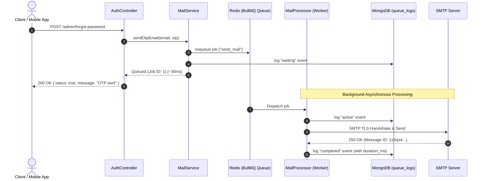
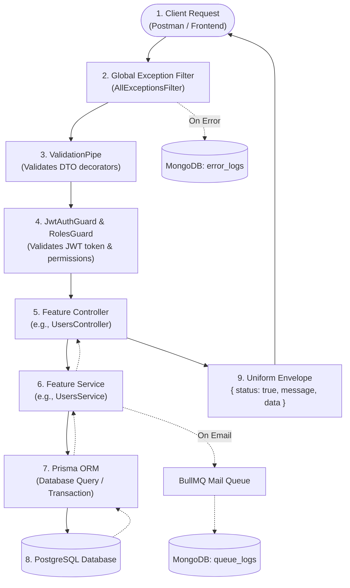

# NestJS Architecture & Core Concepts Guide

This guide explains the foundational architectural patterns used in this project, specifically comparing them to familiar **Laravel** concepts for developers transitioning between the two frameworks.

---

## 📑 Table of Contents
1. [The NestJS "Holy Trinity" (`Controller`, `Service`, `Module`)](#1-the-nestjs-holy-trinity-controller-service-module)
2. [What are DTOs and Why Are They in Feature Folders?](#2-what-are-dtos-and-why-are-they-in-feature-folders)
3. [Background Queues: NestJS BullMQ vs. Laravel `queue:work`](#3-background-queues-nestjs-bullmq-vs-laravel-queuework)
4. [Request Lifecycle Diagram](#4-request-lifecycle-diagram)

---

## 1. The NestJS "Holy Trinity" (`Controller`, `Service`, `Module`)

Every feature in NestJS (such as `users`, `roles`, `auth`) is composed of three core files:

```text
src/modules/admin/users/
├── users.controller.ts   ⚙️ (Routing & HTTP Layer)
├── users.service.ts      🅰️ (Business Logic & Database Layer)
└── users.module.ts       🅰️ (Dependency Injection & Module Container)
```

### Direct Comparison with Laravel

| NestJS File | Laravel Equivalent | Primary Responsibility |
|---|---|---|
| `*.controller.ts` | `app/Http/Controllers/UserController.php` | Handles HTTP routing, extracts `@Body()` / `@Param()`, validates input via DTOs, and returns uniform `{ status, message, data }` responses. |
| `*.service.ts` | `app/Services/UserService.php` or Model queries | Contains pure business logic: Prisma DB queries, transactions, bcrypt hashing, and domain rules. No HTTP-specific objects live here. |
| `*.module.ts` | `app/Providers/UserServiceProvider.php` | The Dependency Injection container. Tells NestJS which controllers to register, which services to instantiate, and what to export to other modules. |

### Why This Separation Matters:
- **Clean Controllers**: Controllers stay slim (typically 3–5 lines per endpoint), acting solely as HTTP traffic directors.
- **Reusability**: Because `UsersService` knows nothing about HTTP or Express, its methods can be called by controllers, BullMQ queue workers, CLI commands, or cron jobs without modification.
- **Testability**: Services can be unit-tested in isolation by mocking the database layer.

---

## 2. What are DTOs and Why Are They in Feature Folders?

### What is a DTO?
**DTO** stands for **Data Transfer Object**. In NestJS, a DTO serves the **exact same purpose as a Laravel Form Request** (`app/Http/Requests/CreateUserRequest.php`).

```typescript
// src/modules/admin/users/dto/create-user.dto.ts
import { ApiProperty } from '@nestjs/swagger';
import { IsEmail, IsNotEmpty, IsString, MinLength } from 'class-validator';

export class CreateUserDto {
    @ApiProperty({ example: 'john@example.com' })
    @IsEmail({}, { message: 'Must be a valid email address' })
    @IsNotEmpty()
    email: string;

    @ApiProperty({ example: 'SecurePassword123!' })
    @IsString()
    @MinLength(8, { message: 'Password must be at least 8 characters' })
    password: string;
}
```

### Laravel vs. NestJS Request Validation

| Feature | Laravel | NestJS (This Architecture) |
|---|---|---|
| **Validation Rules** | `rules()` method in `FormRequest` | Class-validator decorators (`@IsEmail()`, `@IsNotEmpty()`) |
| **Type Safety** | Untyped `$request->validated()` array | Strict TypeScript types (`dto.email`, `dto.password`) |
| **Interactive Docs** | Manual annotations or extra packages | `@ApiProperty()` automatically drives Swagger UI & Postman export |
| **Auto Transformation** | Middleware or manual casting | `ValidationPipe({ transform: true })` automatically casts types |

### Why Place DTOs in Feature-Specific Folders?
```text
src/modules/admin/users/
├── dto/
│   ├── create-user.dto.ts    <-- Rules for POST /users/create
│   ├── update-user.dto.ts    <-- Rules for POST /users/update/:id
│   └── filter-user.dto.ts    <-- Rules for GET /users/list pagination & filters
```

- **Domain Encapsulation**: Everything related to the `users` feature is self-contained inside `src/modules/admin/users/`.
- **Zero Confusion**: In large projects with 50+ database tables, placing all request classes in one global folder causes name clashes and cluttered navigation.
- **Portability**: If you ever want to reuse the `users` or `roles` module in another project, you simply copy the feature directory.

---

## 3. Background Queues: NestJS BullMQ vs. Laravel `queue:work`

### Do You Need a Separate Command Like `php artisan queue:work`?

> [!IMPORTANT]
> **Short Answer: No!** In this architecture, BullMQ runs concurrently inside the main application process. When you run `pnpm run start:dev`, both the HTTP server and the BullMQ mail worker start together automatically.

### Why Does Laravel Require an Extra Process While NestJS Does Not?

#### 1. Laravel (PHP-FPM Architecture)
- PHP runs on a **shared-nothing, request-and-die** model. When an HTTP request finishes, the PHP process terminates immediately.
- Because PHP cannot keep background workers alive after an HTTP request exits, Laravel **requires a persistent background daemon** running in a separate terminal:
  ```bash
  php artisan queue:work   # (Must be kept alive via Supervisor/Systemd)
  ```

#### 2. NestJS (Node.js Event Loop Architecture)
- Node.js is an **always-alive, asynchronous, event-driven runtime**.
- The application process stays in memory indefinitely.
- Our `MailProcessor` (`@Processor('mail')`) and `MailQueueEventsListener` listen directly to Redis via BullMQ inside the running app.
- When an endpoint calls `mailService.sendOtpEmail(...)`:
  1. The API enqueues the job into Redis in **~30 milliseconds** and immediately returns a success response to the client.
  2. The background `MailProcessor` picks up the job from the Redis queue and dispatches the email via SMTP in the background.
  3. Every queue lifecycle event (`waiting`, `active`, `completed`, `failed`) is automatically recorded in MongoDB's **`queue_logs`** collection.



---

## 4. Request Lifecycle Diagram

Here is how an incoming request travels through this NestJS architecture:



---

## 💡 Quick Reference Summary

- **DTO**: Your input validator (like Laravel's `FormRequest`). Keeps request data clean, typed, and validated before touching your business logic.
- **Controller**: Your traffic officer. Routes HTTP requests to the right service method.
- **Service**: Your business engine. Handles calculations, database mutations, and third-party services.
- **Module**: The blueprint that connects controllers, services, and external libraries together.
- **BullMQ**: High-performance background queue that runs directly in the Node.js event loop with no separate worker command needed for local development.
