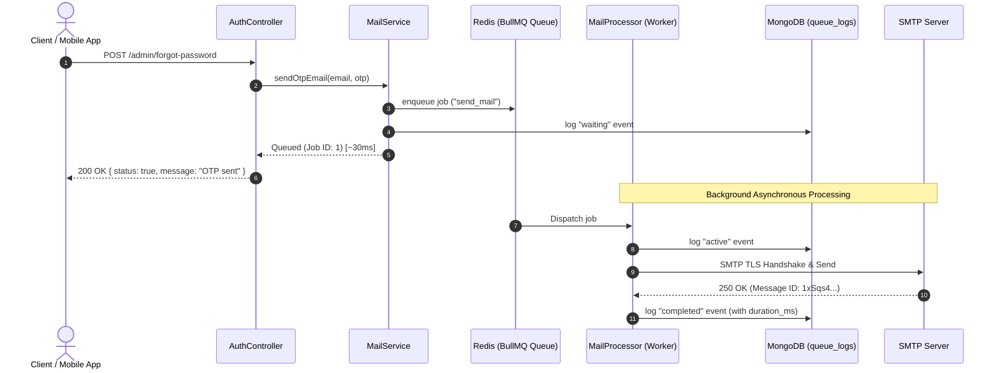

# NestJS Architecture & Core Concepts Guide

This guide explains the foundational architectural patterns used in this project, covering feature modules, Data Transfer Objects (DTOs), background queue processing, and the complete request lifecycle.

---

## 📑 Table of Contents
1. [Feature Module Structure (`Controller`, `Service`, `Module`, `DTO`, `Views`)](#1-feature-module-structure-controller-service-module-dto-views)
2. [What are DTOs and Why Are They in Feature Folders?](#2-what-are-dtos-and-why-are-they-in-feature-folders)
3. [Background Queues: Embedded BullMQ Worker Processing](#3-background-queues-embedded-bullmq-worker-processing)
4. [Request Lifecycle Diagram](#4-request-lifecycle-diagram)
5. [Quick Reference Summary](#5-quick-reference-summary)

---

## 1. Feature Module Structure (`Controller`, `Service`, `Module`, `DTO`, `Views`)

Every feature module in NestJS (such as `users`, `roles`, `auth`) is self-contained with its own routing, business logic, validation, and email/document views:

```text
src/modules/admin/users/
├── dto/                  📦 (Validation rules: create-user.dto.ts, update-user.dto.ts)
├── views/                🎨 (Feature views: otp.hbs, welcome.hbs)
├── users.controller.ts   ⚙️ (Routing & HTTP Layer)
├── users.service.ts      🅰️ (Business Logic & Database Layer)
└── users.module.ts       🅰️ (Dependency Injection & Module Container)
```

### Component Responsibilities

| File / Folder | Primary Responsibility |
|---|---|
| `*.controller.ts` | Handles HTTP routing, extracts `@Body()` / `@Param()`, validates input via DTOs, and returns uniform `{ status, message, data }` responses. |
| `*.service.ts` | Contains pure business logic: Prisma DB queries, transactions, bcrypt hashing, and domain rules. No HTTP-specific objects live here. |
| `*.module.ts` | The Dependency Injection container. Tells NestJS which controllers to register, which services to instantiate, and what to export to other modules. |
| `dto/` | Data Transfer Objects that validate and type-cast incoming request payloads before the controller receives them. |
| `views/` | Feature-specific email and document templates (e.g. `users/views/otp.hbs`). |

### Why This Separation Matters:
- **Clean Controllers**: Controllers stay slim (typically 3–5 lines per endpoint), acting solely as HTTP traffic directors.
- **Reusability**: Because `UsersService` knows nothing about HTTP or Express, its methods can be called by controllers, BullMQ queue workers, CLI commands, or cron jobs without modification.
- **Testability**: Services can be unit-tested in isolation by mocking the database layer.

---

## 2. What are DTOs and Why Are They in Feature Folders?

### What is a DTO?
**DTO** stands for **Data Transfer Object**. In NestJS, a DTO defines the exact schema and validation rules for incoming requests.

```typescript
// src/modules/admin/users/dto/create-user.dto.ts
import { ApiProperty } from '@nestjs/swagger';
import { IsEmail, IsNotEmpty, IsString, MinLength } from 'class-validator';

export class CreateUserDto {
    @ApiProperty({ example: 'john@example.com' })
    @IsEmail({}, { message: 'Must be a valid email address' })
    @IsNotEmpty()
    email: string;

    @ApiProperty({ example: 'SecurePassword123!' })
    @IsString()
    @MinLength(8, { message: 'Password must be at least 8 characters' })
    password: string;
}
```

### Key Advantages of DTO-Driven Validation

| Feature | How It Works in This Architecture |
|---|---|
| **Validation Rules** | Declarative decorators (`@IsEmail()`, `@IsNotEmpty()`, `@MinLength()`) run automatically via the global `ValidationPipe`. |
| **Type Safety** | TypeScript guarantees compile-time type safety throughout services and controllers (`dto.email`, `dto.password`). |
| **Interactive Docs** | `@ApiProperty()` automatically powers Swagger OpenAPI documentation and Postman collection exports without extra boilerplate. |
| **Auto Transformation** | `ValidationPipe({ transform: true })` automatically parses query strings, numbers, and boolean types cleanly. |

### Why Place DTOs in Feature-Specific Folders?
```text
src/modules/admin/users/
├── dto/
│   ├── create-user.dto.ts    <-- Rules for POST /users/create
│   ├── update-user.dto.ts    <-- Rules for POST /users/update/:id
│   └── filter-user.dto.ts    <-- Rules for GET /users/list pagination & filters
```

- **Domain Encapsulation**: Everything related to the `users` feature is self-contained inside `src/modules/admin/users/`.
- **Zero Confusion**: In large projects with 50+ database tables, placing all request classes in one global folder causes name clashes and cluttered navigation.
- **Portability**: If you ever want to reuse the `users` or `roles` module in another project, you simply copy the feature directory.

---

## 3. Background Queues: Embedded BullMQ Worker Processing

### Do You Need a Separate Command to Process Background Queues?

> [!IMPORTANT]
> **No!** In this architecture, BullMQ runs concurrently inside the main application process. When you run `pnpm run start:dev`, both the HTTP server and the BullMQ mail worker start together automatically.

### Why Embedded Queues Work Seamlessly in NestJS

Node.js is an **always-alive, asynchronous, event-driven runtime**. Because the process stays continuously in memory:
- Our `MailProcessor` (`@Processor('mail')`) and `MailQueueEventsListener` listen directly to Redis via BullMQ inside the running app.
- When an endpoint calls `mailService.sendOtpEmail(...)`:
  1. The API enqueues the job into Redis in **~30 milliseconds** and immediately returns a success response to the client.
  2. The background `MailProcessor` picks up the job from the Redis queue and dispatches the email via SMTP in the background.
  3. Every queue lifecycle event (`waiting`, `active`, `completed`, `failed`) is automatically recorded in MongoDB's **`queue_logs`** collection.



---

## 4. Request Lifecycle Diagram

Here is how an incoming request travels through this NestJS architecture:


---

## 5. Quick Reference Summary

- **DTO**: Your input validator and type definition. Keeps request data clean, typed, and validated before touching your business logic.
- **Controller**: Your traffic router. Routes HTTP requests to the right service method and returns uniform responses.
- **Service**: Your business engine. Handles calculations, database mutations, and third-party integrations.
- **Module**: The blueprint that connects controllers, services, and external libraries together.
- **BullMQ**: High-performance background queue that runs directly in the Node.js event loop with no separate worker command needed for local development.
